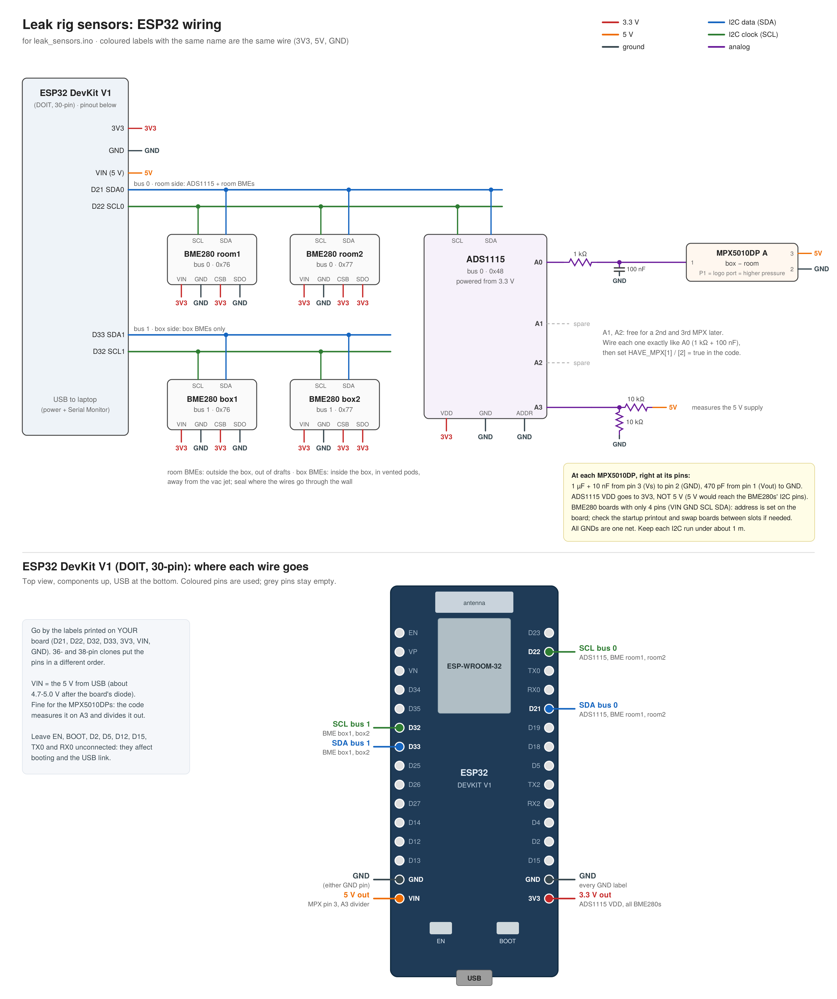

# LEAK_DAQ_ESP32 — MH-60 leak rig data logger

ESP32 firmware and PC tools for the leakage-rate test rig. The ESP32 reads one pitot
pressure sensor and four box/room barometric sensors and streams them to the laptop.
VS Code saves every run to `logs/` as a CSV, and one click averages the steady parts
of the run.

```
 pitot tube ──► MPX5010DP ──► ADS1115 ─┐
 box sensors  (BME/BMP280 ×2, I2C bus 1)├──► ESP32 ──USB──► VS Code Serial Monitor ──► logs/run_*.csv ──► Analyze ──► *_trimmed.csv + plot
 room sensors (BME/BMP280 ×2, I2C bus 0)┘
```

---

## Contents

| Path | What it is |
|---|---|
| `src/main.cpp` | The ESP32 program |
| `platformio.ini` | Build settings (board, libraries, serial speed). Don't edit unless you know why. |
| `wiring_diagram.png` | How every wire connects. **Check this first if a sensor says NOT FOUND.** |
| `logs/` | Saved test runs. New runs show up here automatically. |
| `monitor/filter_csvlog.py` | Saves runs to `logs/`. It runs on its own, so you don't need to touch it. |
| `tools/analyze_run.py` | Finds the steady periods in a run and averages them |
| `tools/analyze_latest.bat` | Double-click to analyze the newest run (Windows) |

---

## 1. One-time setup

1. **Install [VS Code](https://code.visualstudio.com/)** and the **PlatformIO IDE** extension
   (Extensions panel → search *PlatformIO* → Install → restart VS Code).
   VS Code also suggests it automatically when you open this folder.
2. **Install [Git](https://git-scm.com/downloads)** if you don't have it.
3. **Get the code.** Pick one:
   - VS Code: `Ctrl+Shift+P` → **Git: Clone** → paste this repo's URL → choose a folder.
   - Terminal: `git clone <this repo's URL>`
4. **Open the folder that contains `platformio.ini`**: *File → Open Folder → `LEAK_DAQ_ESP32`*.
   If you open a parent folder instead, the PlatformIO buttons won't appear in the bottom bar.
5. **USB driver for your ESP32's USB chip.** Look at the small chip next to the USB port:
   - CP2102 / CP210x → *CP210x USB to UART driver* (Silicon Labs)
   - CH340 / CH9102 → *CH340 driver* (WCH)
6. **Use a USB cable that carries data.** Many cheap cables only charge. If the board never
   shows up, try a different cable first.
7. *(Only needed for plots)* Install [Python](https://python.org) and run `pip install matplotlib`.

The first build downloads the ESP32 toolchain and the sensor libraries listed in
`platformio.ini`. This takes a few minutes, and only happens once.

---

## 2. Wiring



| Bus | Pins | Devices |
|---|---|---|
| I2C bus 0 (room side) | D21 SDA, D22 SCL | ADS1115 `0x48`, room1 `0x76`, room2 `0x77` |
| I2C bus 1 (box side) | D33 SDA, D32 SCL | box1 `0x76`, box2 `0x77` |
| Analog | ADS1115 A0 | MPX5010DP output (1 kΩ + 100 nF filter) |
| Analog | ADS1115 A3 | 5 V supply through a 10k/10k divider |

> The diagram labels the MPX as "box – room". In the current firmware, channel **A** is the
> **pitot tube** (P1 = logo port = pitot, facing into the flow; P2 = room). The pins are unchanged.

### Sensor channels (all pressure *differences*)

| Ch | Sensor | Measures |
|---|---|---|
| **A** | MPX5010DP on ADS1115 A0 | pitot − room |
| **B** | BME/BMP280 "box1" | box − room |
| **C** | BME/BMP280 "box2" | box − room |

Room pressure is the average of room1 and room2. BMP280 boards work too.

---

## 3. Upload the program *(only after `main.cpp` changes)*

1. Plug in the ESP32.
2. In the blue bar at the **bottom** of VS Code, click **→ (Upload)**.
3. If it sits on `Connecting......`, **hold BOOT** on the ESP32 until `Writing at 0x...` appears.
4. It's done when you see **SUCCESS**.

The bottom bar has three buttons: ✓ = Build, → = Upload, 🔌 = Serial Monitor.

---

## 4. Start a session *(every time)*

> ⚠️ **The vacuum/system must be OFF when the ESP32 starts.** The ESP32 zeros itself
> 5 s after power-up, using room air as zero. If the system is running at that moment,
> every reading for the whole session is wrong.

1. System OFF, all sensor tubes open to the room.
2. Click the **🔌 plug icon** (Serial Monitor), then press **EN** on the ESP32. You should see:
   ```
   # Leak rig sensors starting
   # ADS1115 0x48 bus0: OK
   # BME280 room1  bus0 0x76: OK
   # BME280 box1   bus1 0x76: OK
   # BME280 room2  bus0 0x77: OK
   # BME280 box2   bus1 0x77: OK
   # AUTO-ZERO in 5 s - keep the system OFF until "ZERO done".
   # ZERO done.
   # Ready: turn the system on, then type run (or log) to record, stop to end.
   ```
3. Turn the system on only after you see **Ready**.

Nothing scrolls until you type `run`. That's normal.

---

## 5. Record a test run

| Do this | Effect |
|---|---|
| type `run` + Enter | Starts recording to `logs/run_<date>_<time>.csv` |
| press `+` *(no Enter)* | Next outlet-area label: A, then B, then C … |
| press `-` *(no Enter)* | "Slider moving": rows stay unlabelled |
| `mano 0.30 0.28` + Enter | *(optional)* left/right manometer readings for this area |
| type `stop` + Enter | Stops recording and writes the per-area summary |

Rhythm: **`+` → hold ~10 s → `-` → move slider → `+` → hold ~10 s → …**

While recording, the screen only shows every 4th line so you have room to type, but **every
line is saved**. If the ESP32 resets mid-run, the file is closed and kept.

Each run produces:

- `run_<date>_<time>.csv`: every reading at 2 Hz (opens in Excel)
- `run_<date>_<time>_summary.csv`: averages of every column for each area label

Log columns: `time, t_s, area, A_pitot_room_<u>, A_avg_5s_<u>, B_bme_box1_<u>, C_bme_box2_<u>, mano_<u>, P_room_Pa, T_room_C, T_box_C, Vs_V, flags`, where `<u>` is the current units (inH2O by default).

---

## 6. Analyze a run

Pick one of these:

- **Double-click `tools/analyze_latest.bat`**. It analyzes the newest run, prints a table and opens the plot.
- **VS Code:** PlatformIO sidebar (alien-head icon) → *PROJECT TASKS → Custom → Analyze latest run*,
  or *Terminal → Run Build Task* (`Ctrl+Shift+B`).
- **Terminal:**
  ```bash
  python tools/analyze_run.py                       # newest run
  python tools/analyze_run.py logs/run_....csv      # a specific run
  python tools/analyze_run.py --trim 3 --min 8      # trim 3 s off each edge, keep plateaus ≥ 8 s
  ```

The script finds the steady periods on its own, so it still works if you forgot to label areas. It writes these files next to the log:

- `run_..._trimmed.csv`: one row per steady period, with means and standard deviations
- `run_..._trimmed.png`: a plot of the run, with green shading on the data that was kept

| Message | Meaning |
|---|---|
| `skipped ... too short` | The slider wasn't held still long enough |
| `No steady plateaus found` | Try `python tools/analyze_run.py --min 2 --window 2` |
| Table but no plot | Run `pip install matplotlib` |

---

## 7. Calibrate against the manometer *(only when needed)*

Calibration is **stored on the ESP32** and survives unplugging. Only redo it if you change
a sensor or tubing, or if the numbers disagree with the manometer.

The manometer is a Dwyer U-tube with red 0.826 SG fluid, mounted at 30°. This is already
built into the code, so you just type what the ruler says on each side.

1. Don't type `run`. Type **`cal A`** (or `cal B` / `cal C`).
2. First point: system OFF, type `0` + Enter.
3. System on. Set the slider and wait until the fluid is still.
4. Type both sides of the ruler, e.g. `1.20 1.15` + Enter, and hold still for 3 s.
5. Repeat steps 3–4 for 5–8 slider positions.
6. Type **`done`** to save. (`u` = undo last point, `q` = quit without saving.)

A gain near 1.0 and R² near 1.0 means a good fit. If you see "Slope is negative", the tubes
are on the wrong ports, so swap them.

---

## All serial commands

Type `h` in the monitor to see this list on the ESP32 itself.

| Command | Does |
|---|---|
| `run` / `log` | Start recording to `logs/` |
| `stop` | Stop recording |
| `+` / `-` | Next area label / slider moving (one key, no Enter) |
| `area B` | Set the area label by hand (`area` alone clears it) |
| `mano L R` | Manometer left/right readings for the current area |
| `z` | Zero again (system OFF, tubes open to room) |
| `cal A` | Calibrate a channel (A, B or C) against the manometer |
| `units in` / `mm` / `pa` | Units for the stream (inH2O, mmH2O, Pa) |
| `vs 5.02` | Enter what a multimeter reads on the 5 V pin (one time) |
| `p` | Print the current calibration |
| `scan` | List every I2C device found (wiring check) |
| `reset` | Reset calibration to defaults |
| `h` | Help |

### `flags` column

| Flag | Meaning |
|---|---|
| `OVERA` | Pitot sensor maxed out |
| `PINNEDA` | Pitot sensor stuck at 0 V: tubes on the wrong ports, swap them |
| `VS` | 5 V supply out of range (4.5–5.3 V): check USB power |
| `NO_ADS` | ADC board not answering: check its wiring |

---

## Troubleshooting

| Problem | Fix |
|---|---|
| No COM port / "could not open port" | Try a different (data) cable, install the USB driver, try another USB port. Close the Arduino IDE or any other monitor that has the port open. |
| Upload stuck on `Connecting......` | Hold **BOOT** while it connects |
| Garbage characters in the monitor | Press **EN** (speed is 115200, already set) |
| Nothing scrolling | Type `run`. Data only streams while recording. |
| A sensor says NOT FOUND | Check `wiring_diagram.png`, then type `scan`. Loose jumpers are the #1 cause. |
| `bus1 SKIPPED` | A box-sensor wire (D32/D33) is shorted, or a box sensor has no power. Fix it, then press EN. |
| Readings aren't ~0 with the system off | The system was on at startup. Turn it off and type `z` (or press EN). |
| Nothing appears in `logs/` | You didn't type `run`, or you used a different serial monitor. Only the PlatformIO 🔌 monitor saves files. |
| `+` and `-` do nothing | Click inside the monitor first, and press them at the **start** of a line |

---

## Working on this together

- **Before a session:** in Source Control, click *Sync* or **Pull** to get the latest code.
- **After a session:** commit your new `logs/` files with a short message
  (e.g. `Runs 10/15 – slider areas A–F`) and **Push**, so everyone has the data.
  Log names are timestamped, so two people's runs never collide.
- **Changing `main.cpp`:** say so in the commit message. Everyone needs to re-upload (step 3)
  after pulling it.
- Build output (`.pio/`) and machine-specific VS Code files are git-ignored. PlatformIO
  re-downloads libraries automatically on the first build.
