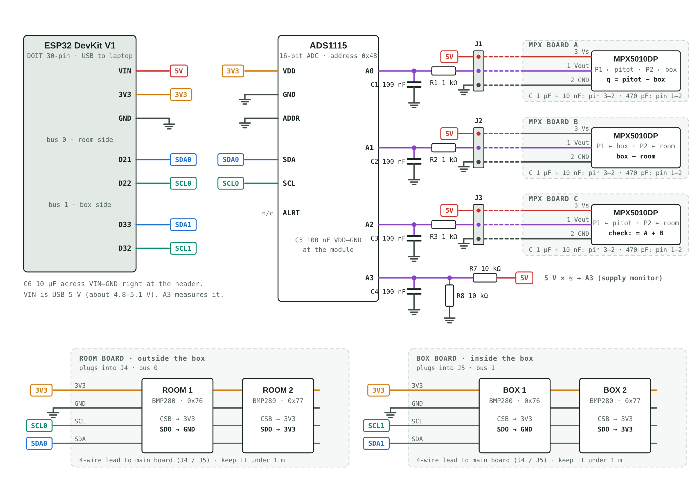
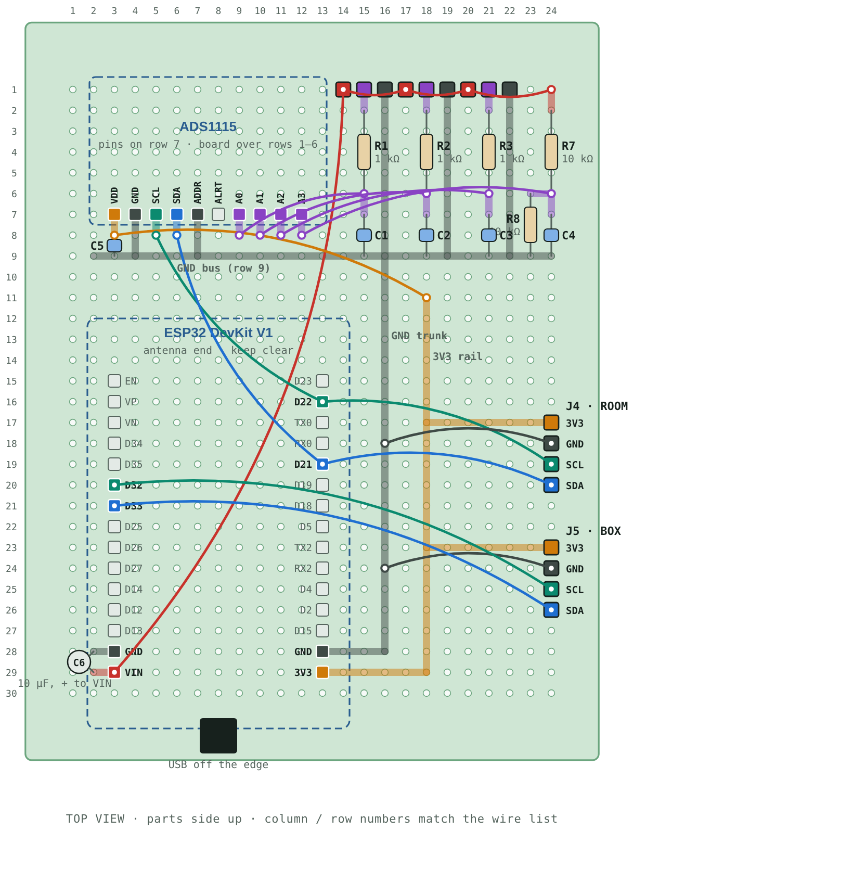
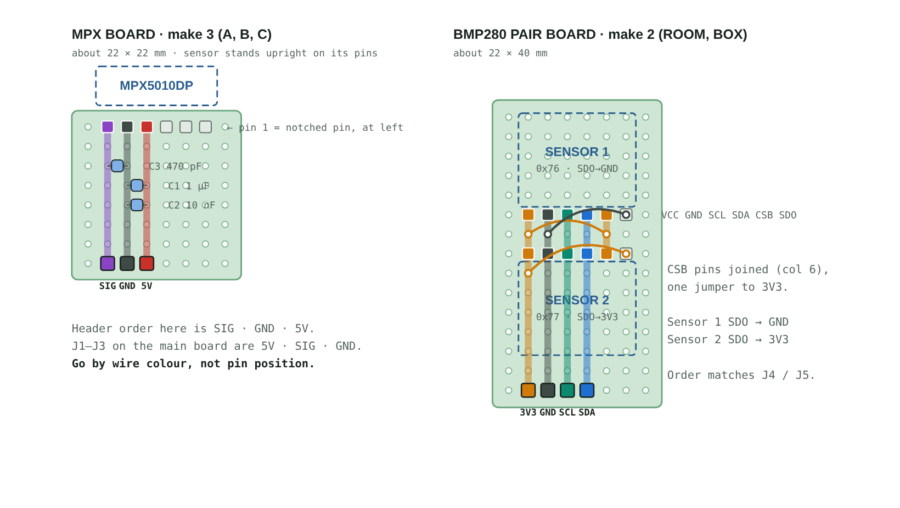

# LEAK_DAQ_ESP32 — MH-60 leak rig data logger

ESP32 firmware and PC tools for the leakage-rate test rig. The ESP32 reads three differential
pressure sensors and four barometric sensors and streams them to the laptop. VS Code saves every
run to `logs/`, and one click averages the steady parts of the run and works out the inflow and
the leak area.

**Current hardware: DAQ REV-C** (3 × MPX5010DP + 4 × BME/BMP280). Older revisions are kept; see
[Revisions](#revisions).

```
 pitot ─┬─► MPX A (pitot − box)  ─┐
        └─► MPX C (pitot − room) ─┼─► ADS1115 ─┐
 box ───┬─► MPX B (box − room)   ─┘            │
        └─  (tee to MPX A P2)                  ├──► ESP32 ──USB──► VS Code ──► logs/REV-C/run_*.csv ──► Analyze ──► *_trimmed.csv + plot
 box sensors  (BME/BMP280 ×2, I2C bus 1) ──────┤
 room sensors (BME/BMP280 ×2, I2C bus 0) ──────┘
```

---

## Contents

| Path | What it is |
|---|---|
| `src/main.cpp` | The ESP32 program (REV-C) |
| `platformio.ini` | Build settings (board, libraries, serial speed). Don't edit unless you know why. |
| `wiring/` | REV-C schematic, 70×90 main-board layout, small-board layouts, and a full solder guide (`REV-C_solder_guide.html`, open it in a browser). **Check these first if a sensor says NOT FOUND.** |
| `logs/REV-C/` | New test runs. They show up here automatically. |
| `logs/REV-A/`, `logs/REV-B/` | Runs recorded with the older hardware, kept as they were |
| `monitor/filter_csvlog.py` | Saves runs to `logs/`. It runs on its own, so you don't need to touch it. |
| `tools/analyze_run.py` | Finds the steady periods in a run, averages them, works out q, flow and leak area. Reads logs from every revision. |
| `tools/analyze_latest.bat` | Double-click to analyze the newest run (Windows) |
| `revisions/` | Frozen copies of older firmware, tools, wiring and READMEs |

---

## Revisions

The DAQ revision letters are for this data logger only. They are separate from the letters used
for the rig's inlet hardware (for example "Rev B straightener").

| Rev | Dates | Hardware | Channels | Where it lives |
|---|---|---|---|---|
| **REV-A** | 15 Oct (first two runs) | 1 × MPX5010DP + 4 × BME | A = MPX box − room; B, C = BME box − room | `logs/REV-A/` only. The firmware was changed before it was committed, so it isn't in git. See `revisions/REV-A/README.md`. |
| **REV-B** | 15–16 Oct | Same parts, MPX moved to the pitot | A = MPX pitot − room; B, C = BME box − room | git tag **`REV-B`**, `revisions/REV-B/`, `logs/REV-B/` |
| **REV-C** | from 27 Oct | 3 × MPX5010DP + 4 × BME | A = MPX pitot − box (q); B = MPX box − room; C = MPX pitot − room; D = BME box − room | `main` (this README), git tag **`REV-C`** |

**Why REV-C:** in REV-B the box pressure came from subtracting two separate barometers. Each BME is
only good to about ±12 Pa against another one, so B and C disagreed by 8–13 Pa. In REV-C, an MPX
reads box − room directly across one diaphragm, and another reads q = pitot − box directly. The BMEs
are kept for air density (room pressure, temperature, humidity), box temperature, and a rough check (D).

**Using an old revision.** To flash REV-B firmware again:
`git checkout REV-B`, then Upload (step 3), then `git checkout main` to come back.
Each revision stores its calibration separately on the ESP32, so switching never wipes the other one.
`tools/analyze_run.py` on `main` reads REV-A, REV-B and REV-C logs, so you don't need to check out
anything to re-analyze an old run.

---

## 1. One-time setup

1. **Install [VS Code](https://code.visualstudio.com/)** and the **PlatformIO IDE** extension
   (Extensions panel → search *PlatformIO* → Install → restart VS Code).
   VS Code also suggests it automatically when you open this folder.
2. **Install [Git](https://git-scm.com/downloads)** if you don't have it.
3. **Get the code.** Pick one:
   - VS Code: `Ctrl+Shift+P` → **Git: Clone** → paste this repo's URL → choose a folder.
   - Terminal: `git clone <this repo's URL>`
4. **Open the folder that contains `platformio.ini`**: *File → Open Folder → `LEAK_DAQ_ESP32`*.
   If you open a parent folder instead, the PlatformIO buttons won't appear in the bottom bar.
5. **USB driver for your ESP32's USB chip.** Look at the small chip next to the USB port:
   - CP2102 / CP210x → *CP210x USB to UART driver* (Silicon Labs)
   - CH340 / CH9102 → *CH340 driver* (WCH)
6. **Use a USB cable that carries data.** Many cheap cables only charge. If the board never
   shows up, try a different cable first.
7. *(Only needed for plots)* Install [Python](https://python.org) and run `pip install matplotlib`.

The first build downloads the ESP32 toolchain and the sensor libraries listed in
`platformio.ini`. This takes a few minutes, and only happens once.

---

## 2. Wiring (REV-C)

Full details, including a hole-by-hole wire list and the parts list, are in
**`wiring/REV-C_solder_guide.html`** (open it in a browser).



| Bus / input | Pins | Devices |
|---|---|---|
| I2C bus 0 (room side) | D21 SDA, D22 SCL | ADS1115 `0x48`, room1 `0x76`, room2 `0x77` |
| I2C bus 1 (box side) | D33 SDA, D32 SCL | box1 `0x76`, box2 `0x77` |
| ADS1115 A0 | through 1 kΩ, 100 nF to GND | MPX A output |
| ADS1115 A1 | through 1 kΩ, 100 nF to GND | MPX B output |
| ADS1115 A2 | through 1 kΩ, 100 nF to GND | MPX C output |
| ADS1115 A3 | 10k/10k divider, 100 nF to GND | 5 V supply |

Each MPX sits on its own small board with 1 µF + 10 nF from pin 3 to pin 2 and 470 pF from pin 1
to pin 2, right at its pins. Each pair of BMEs (room, box) shares one small board and one 4-wire lead.
Set SDO on every BME: sensor 1 to GND (`0x76`), sensor 2 to 3V3 (`0x77`).

**Main board, 70 × 90 mm perfboard:**



**Small boards:**



### Tubing

P1 is the port on the logo side. It's always the higher pressure.

| MPX | ADS | P1 | P2 | Reads |
|---|---|---|---|---|
| **A** | A0 | pitot | box tap | q = pitot − box (velocity pressure) |
| **B** | A1 | box tap | open to room | box − room |
| **C** | A2 | pitot | open to room | pitot − room, should equal A + B |

Tee the box tap to A P2 and B P1, and the pitot line to A P1 and C P1. Box pressure is the right
static reference for the pitot because the inlet discharges into the box as a free jet.

### Sensor channels (all pressure *differences*)

| Ch | Sensor | Measures |
|---|---|---|
| **A** | MPX A on ADS1115 A0 | pitot − box (q) |
| **B** | MPX B on ADS1115 A1 | box − room |
| **C** | MPX C on ADS1115 A2 | pitot − room (closure check) |
| **D** | BME box (avg of box1, box2) − BME room (avg) | box − room, rough cross-check on B |

BMP280 boards work too (no humidity, so `RH_room_pct` stays blank). If you leave MPX C off, set
`HAVE_MPX[2]` to `false` near the top of `src/main.cpp`. Its column then stays blank and is never flagged.

---

## 3. Upload the program *(only after `main.cpp` changes)*

1. Plug in the ESP32.
2. In the blue bar at the **bottom** of VS Code, click **→ (Upload)**.
3. If it sits on `Connecting......`, **hold BOOT** on the ESP32 until `Writing at 0x...` appears.
4. It's done when you see **SUCCESS**.

The bottom bar has three buttons: ✓ = Build, → = Upload, 🔌 = Serial Monitor.

> After the first REV-C upload, the ESP32 starts with default calibration (gain 1 on every channel).
> Do the manometer calibration (step 7) for A, B and C before trusting the numbers.

---

## 4. Start a session *(every time)*

> ⚠️ **The vacuum/system must be OFF when the ESP32 starts.** The ESP32 zeros itself
> 5 s after power-up, using room air as zero. If the system is running at that moment,
> every reading for the whole session is wrong.

1. System OFF, all sensor tubes open to the room.
2. Click the **🔌 plug icon** (Serial Monitor), then press **EN** on the ESP32. You should see:
   ```
   # Leak rig sensors starting  (firmware REV-C: 3 x MPX + 4 x BME)
   # ADS1115 0x48 bus0: OK
   # BME280 room1  bus0 0x76: OK
   # BME280 box1   bus1 0x76: OK
   # BME280 room2  bus0 0x77: OK
   # BME280 box2   bus1 0x77: OK
   # AUTO-ZERO in 5 s - keep the system OFF until "ZERO done".
   # ZERO done.
   # Ready: turn the system on, then type run (or log) to record, stop to end.
   ```
3. Turn the system on only after you see **Ready**.

Nothing scrolls until you type `run`. That's normal.

---

## 5. Record a test run

| Do this | Effect |
|---|---|
| type `run` + Enter | Starts recording to `logs/REV-C/run_<date>_<time>.csv` |
| press `+` *(no Enter)* | Next outlet-area label: A, then B, then C … |
| press `-` *(no Enter)* | "Slider moving": rows stay unlabelled |
| `mano 0.30 0.28` + Enter | *(optional)* left/right manometer readings for this area |
| type `stop` + Enter | Stops recording and writes the per-area summary |

Rhythm: **`+` → hold ~15 s → `-` → move slider → `+` → hold ~15 s → …**

While recording, the screen only shows every 4th line so you have room to type, but **every
line is saved**. If the ESP32 resets mid-run, the file is closed and kept.

Each run produces:

- `run_<date>_<time>.csv`: every reading at 2 Hz (opens in Excel)
- `run_<date>_<time>_summary.csv`: averages of every column for each area label

REV-C log columns:
`time, t_s, area, A_q_pitot_box_<u>, A_avg_5s_<u>, B_box_room_<u>, C_pitot_room_<u>, D_bme_box_room_<u>, mano_<u>, P_room_Pa, T_room_C, RH_room_pct, T_box_C, Vs_V, flags`,
where `<u>` is the current units (inH2O by default).

---

## 6. Analyze a run

Pick one of these:

- **Double-click `tools/analyze_latest.bat`**. It analyzes the newest run, prints a table and opens the plot.
- **VS Code:** PlatformIO sidebar (alien-head icon) → *PROJECT TASKS → Custom → Analyze latest run*,
  or *Terminal → Run Build Task* (`Ctrl+Shift+B`), which also opens the plot.
- **Terminal:**
  ```bash
  python tools/analyze_run.py                              # newest run (any revision)
  python tools/analyze_run.py logs/REV-B/run_....csv       # a specific run
  python tools/analyze_run.py --trim 3 --min 8             # trim 3 s off each edge, keep plateaus ≥ 8 s
  python tools/analyze_run.py --k 0.94                     # pitot coefficient, once it's calibrated
  ```

The script reads the column names to tell which DAQ revision recorded the log. It finds the steady
periods on its own, so it still works if you forgot to label areas. For each steady period with the
system on, it works out:

| Result | Formula | Notes |
|---|---|---|
| `q_Pa` | REV-C: A; REV-B: A − box | velocity pressure at the pitot |
| `Q_cfm` | k · A_pipe · √(2q / ρ) | inflow. ρ from room pressure, temperature and humidity |
| `CdA_mm2` | k · A_pipe · √(q / box) | effective leak area (instructor's formula) |
| `closure_Pa` | C − (A + B) | REV-C only. Should be near 0. If it's large, recalibrate or check the tees. |

A_pipe = 2669 mm² (58.3 mm bore). k = 1 until the pitot is calibrated on the box with known openings.
Pass the calibrated value with `--k`.

It writes these files next to the log:

- `run_..._trimmed.csv`: one row per steady period, with means, standard deviations, q, Q and CdA
- `run_..._trimmed.png`: the run plotted with each steady section shaded and labeled (Zero, Area A, …), plus a table of each section's trimmed averages

| Message | Meaning |
|---|---|
| `skipped ... too short` | The slider wasn't held still long enough |
| `No steady plateaus found` | Try `python tools/analyze_run.py --min 2 --window 2` |
| Table but no plot | Run `pip install matplotlib` |

---

## 7. Calibrate against the manometer *(only when needed)*

Calibration is **stored on the ESP32** and survives unplugging. Redo it after the first REV-C upload,
after you change a sensor or tubing, or if the numbers disagree with the manometer.

The manometer is a Dwyer U-tube with red 0.826 SG fluid, mounted at 30°. This is already
built into the code, so you just type what the ruler says on each side.

1. Don't type `run`. Type **`cal A`** (or `cal B`, `cal C`, `cal D`).
2. Plumb it as the screen says. For an MPX: manometer teed onto its **P1** line, and its **P2** open to
   the room. MPX B's P2 is already on the room, so it calibrates without replumbing.
   Put A's and C's P2 back on their normal lines afterwards.
3. First point: system OFF, type `0` + Enter.
4. System on. Set the slider and wait until the fluid is still.
5. Type both sides of the ruler, e.g. `1.20 1.15` + Enter, and hold still for 3 s.
6. Repeat steps 4–5 for 5–8 slider positions.
7. Type **`done`** to save. (`u` = undo last point, `q` = quit without saving.)

A gain near 1.0 and R² near 1.0 means a good fit. If you see "Slope is negative", the tubes
are on the wrong ports, so swap them. After A, B and C are calibrated, `closure_Pa` from the
analysis should be within a few Pa of 0.

---

## All serial commands

Type `h` in the monitor to see this list on the ESP32 itself.

| Command | Does |
|---|---|
| `run` / `log` | Start recording to `logs/REV-C/` |
| `stop` | Stop recording |
| `+` / `-` | Next area label / slider moving (one key, no Enter) |
| `area B` | Set the area label by hand (`area` alone clears it) |
| `mano L R` | Manometer left/right readings for the current area |
| `z` | Zero again (system OFF, tubes open to room) |
| `cal A` | Calibrate a channel (A, B, C or D) against the manometer |
| `units in` / `mm` / `pa` | Units for the stream (inH2O, mmH2O, Pa) |
| `vs 5.02` | Enter what a multimeter reads on the 5 V pin (one time) |
| `p` | Print the current calibration and firmware revision |
| `scan` | List every I2C device found (wiring check) |
| `reset` | Reset calibration to defaults |
| `h` | Help |

### `flags` column

| Flag | Meaning |
|---|---|
| `OVERA` / `OVERB` / `OVERC` | That MPX is maxed out (above about 7 kPa) |
| `PINNEDA` / `PINNEDB` / `PINNEDC` | That MPX is stuck at 0 V: its tubes are on the wrong ports, so swap them |
| `VS` | 5 V supply out of range (4.5–5.3 V): check USB power |
| `NO_ADS` | ADC board not answering: check its wiring |

---

## Troubleshooting

| Problem | Fix |
|---|---|
| No COM port / "could not open port" | Try a different (data) cable, install the USB driver, try another USB port. Close the Arduino IDE or any other monitor that has the port open. |
| Upload stuck on `Connecting......` | Hold **BOOT** while it connects |
| Garbage characters in the monitor | Press **EN** (speed is 115200, already set) |
| Nothing scrolling | Type `run`. Data only streams while recording. |
| A sensor says NOT FOUND | Check `wiring/`, then type `scan`. Loose jumpers are the #1 cause. |
| `bus1 SKIPPED` | A box-sensor wire (D32/D33) is shorted, or a box sensor has no power. Fix it, then press EN. |
| `WARNING: MPX B zero ... outside the datasheet band` | That MPX's 5 V, GND or output wire is open, or its board isn't plugged in |
| One MPX reads about −400 Pa or flags `PINNED` | Its tubes are swapped. P1 (logo) must be the higher pressure. |
| `closure_Pa` is tens of Pa | Calibrate A, B and C, then check every tee for leaks |
| Readings aren't ~0 with the system off | The system was on at startup. Turn it off and type `z` (or press EN). |
| Nothing appears in `logs/REV-C/` | You didn't type `run`, or you used a different serial monitor. Only the PlatformIO 🔌 monitor saves files. |
| `+` and `-` do nothing | Click inside the monitor first, and press them at the **start** of a line |

---

## Working on this together

- **Quick push from a terminal** (Windows PowerShell):
  `git add -A; git commit -m "Runs 10/28"; git pull --rebase; git push`
  (or `Ctrl+Alt+P` in VS Code)
- **Before a session:** in Source Control, click *Sync* or **Pull** to get the latest code.
- **After a session:** commit your new `logs/REV-C/` files with a short message
  (e.g. `Runs 10/28 – slider areas A–F`) and **Push**, so everyone has the data.
  Log names are timestamped, so two people's runs never collide.
- **Changing `main.cpp`:** say so in the commit message. Everyone needs to re-upload (step 3)
  after pulling it.
- **New hardware revision:** copy the current firmware, tools, wiring and README into
  `revisions/REV-<letter>/`, tag the last commit (`git tag -a REV-C -m "..."`), make the new firmware
  print the next letter in `FW_REV`, and add a row to [Revisions](#revisions). The logger files each
  revision's runs under `logs/REV-<letter>/` automatically.
- Build output (`.pio/`) and machine-specific VS Code files are git-ignored. PlatformIO
  re-downloads libraries automatically on the first build.
